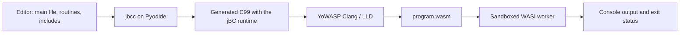

# jBC Playground

The jBC playground compiles and runs multi-file jBC projects in your
browser at [online.jbc-lang.org](https://online.jbc-lang.org/).
The [jbcc repository](https://github.com/jbc-lang/jbcc) maintains the
compiler, runtime, and native CLI.

## How the playground works

GitHub Pages serves the editor and toolchain files. Compilation and
execution happen in your browser.



1. **Pyodide runs the jBC compiler.** Pyodide is CPython compiled to Wasm.
   On the first **Run**, a browser worker starts Pyodide and loads the pinned
   `jbcc 0.2.0` Python wheel. The site build downloads the wheel from PyPI,
   verifies its SHA-256 hash, and serves it with the other static assets.
   [Compiler worker](web/compile-worker.ts) · [Pyodide](https://pyodide.org/en/stable/project/about.html)
2. **jbcc translates jBC to C.** The Python adapter stages the project in a
   temporary virtual filesystem. jbcc expands `$INSERT` and `$INCLUDE`,
   resolves linked routines, and emits one C99 translation with the jBC
   runtime included. The editor can show translation diagnostics at the
   original file, line, and column. [Project adapter](browser.py)
3. **Clang and LLD build the Wasm program.** After translation succeeds, the
   worker loads the Wasm builds of YoWASP Clang and LLD. They compile and
   link the generated C against the WASI C library to produce
   `program.wasm`. [Clang invocation](web/compile-worker.ts#L71)
4. **A separate worker runs the program.** The editor sends the compiled
   Wasm and the prefilled standard input to a fresh worker inside a
   sandboxed iframe. A JavaScript WASI shim provides standard streams,
   clocks, and randomness. `INPUT` reads the supplied bytes through EOF.
   The worker streams stdout and stderr to the console and reports the
   exit status. The program has no mounted directories or access to the
   editor, saved projects, or network.
   [Runner](web/runner.ts) · [WASI imports](web/wasi-program.ts)

Opening the editor downloads no Wasm. A first successful **Run** downloads
roughly 33 MB on a cold browser cache. Later runs in the same tab reuse the
initialized compiler worker and start a fresh execution worker for each
program. A build can take up to two minutes. A program can run for five
seconds and use up to 64 MiB of Wasm memory and 64 KiB of combined output.
**Stop** cancels either phase.
[Compiler lifecycle](web/browser-compiler.ts) · [Run limits](web/runner.ts#L32)

## Local development

With Bun, Python 3, and Just installed, run `just dev` and open
<http://127.0.0.1:18767/>. This builds `dist/playground` and serves it with
Python's static HTTP server.

The browser saves the working draft in localStorage. Use **Project name** and **Save** to keep a named
project in IndexedDB. **Projects** lists the names, and **Load** opens the
chosen save after confirmation. Edits to a saved or loaded project
autosave after a short pause. If another tab updates the same name, the
editor keeps its working draft and reports a conflict. Save under a
different name to keep both versions.

Use **Export** to download the open project as a versioned JSON file.
**Import** can open it in another browser profile. Exports contain the project name, files, **Main**,
linked routines, selected tab, and prefilled stdin.
Browser session values use a virtual working directory of `/`, zero for
the process and port numbers, and an empty OS login.

The lockfile records the npm integrity hashes for Pyodide 314.0.8,
YoWASP Clang 21.1.4-3 (including the WASI sysroot), and browser_wasi_shim
0.4.2. The build copies the package toolchain assets into versioned
paths. See the [Pyodide license](https://github.com/pyodide/pyodide/blob/main/LICENSE),
[YoWASP package license and upstream sources](https://codeberg.org/YoWASP/clang),
[LLVM license](https://llvm.org/LICENSE.txt),
[wasi-libc license](https://github.com/WebAssembly/wasi-libc/blob/main/LICENSE),
and the [WASI shim license](https://github.com/bjorn3/browser_wasi_shim/blob/main/LICENSE-MIT).

## Browser tests

The native comparisons use `uvx` and a C99 compiler. Install the test
dependencies and Chromium, then run the suite.

```sh
bun install --frozen-lockfile
bunx playwright install chromium
just test
```

Set `JBCC_PLAYWRIGHT_CHANNEL=chrome` to use a local Google Chrome
installation. For Playwright Firefox or WebKit, install the engines with
`bunx playwright install firefox webkit` and set
`JBCC_PLAYWRIGHT_BROWSER` to `firefox` or `webkit`.

To test a deployed build, set `JBCC_PLAYGROUND_URL` to the site URL
including its trailing slash. The build from `just build` supplies the
matching wheel for the native comparisons.

## Publishing

GitHub Actions builds and tests pull requests and publishes the static
artifact to GitHub Pages when changes land on `main`. README-only changes
skip this workflow. You can run it manually from the Actions tab.
GitHub Pages serves the custom domain `online.jbc-lang.org`. Local builds
omit Analytics.

The production page loads the Google tag for GA4 measurement ID `G-NCPVZT08XG`.
The repository's Actions variable `JBCC_ENABLE_ANALYTICS=1` enables it
for production deployments.

To render the production HTML locally, run
`JBCC_ENABLE_ANALYTICS=1 bun build-static.mjs`. Serve it at localhost
to inspect the generated page without sending Analytics.

## Writing and running programs

The editor starts with `hello.b`. Choose **Status lookup (3 files)** to
try a program and a subroutine that share an include. Pick the main file
with **Main**. For each separately compiled subroutine or function,
select its tab and check **Link as routine**. Include files are expanded
by `$INSERT` or `$INCLUDE` and can stay unchecked. An include searches
relative to its source file, then relative to the project root. Paths
are case-sensitive. Drafts and the theme are saved in the browser.

Fill **Standard input** before running a program that reads with
`INPUT`. Click **Run** to compile and execute the project.
The **?** button opens help for files, routines, limits, and browser projects.

This version targets console programs. The compiler reports source
locations for unsupported operations such as shell commands, sequential
files and devices, terminal cursor and keyboard controls, timed input,
native C calls, and printer output. Live keystrokes, jBASE file
backends, and T24 services are unavailable.
